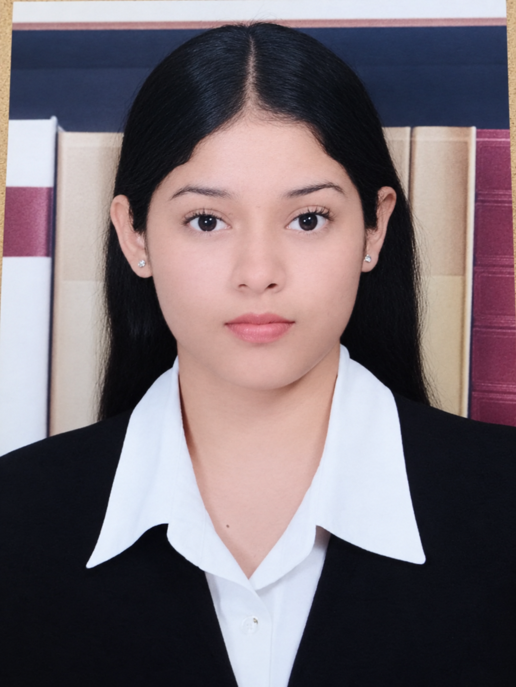

# Portafolio Digital — Jimena Navarrete

## Descripción general
Portafolio personal desarrollado para presentar mis proyectos, habilidades técnicas y personales, formación académica y formulario de contacto directo por correo electrónico. Incluye modales interactivos para explorar cada proyecto con sus detalles, enlaces y evidencias visuales.

## Captura de pantalla del portafolio


## Tecnologías utilizadas
* **Next.js** (React + TypeScript)
* **Tailwind CSS**
* **Git y GitHub**
* **Vercel** (despliegue del portafolio)
* **FormSubmit** (envío de mensajes por correo desde el formulario de contacto)
* Herramientas y conceptos explorados en mis proyectos: **Python**, **Regresión lineal**, **K-Means**, **KNN**, **Algoritmos / Árboles de decisión** y **Análisis geográfico**.

## Instrucciones de instalación
1. Clona este repositorio:
   ```bash
   git clone [https://github.com/jimeeeee123/Portafolio.git](https://github.com/jimeeeee123/Portafolio.git)
   Enlace al portafolio desplegado
Sitio web en vivo:https://portafolio-eosin-pi-42.vercel.app/

Lo aprendido durante el desarrollo
Durante el desarrollo de este portafolio aprendí a estructurar una aplicación web en Next.js, organizar componentes y estados interactivos (como ventanas modales y formularios con retroalimentación de envío), trabajar con estilos responsivos, desplegar proyectos en Vercel y mantener mi código y evidencias ordenadas en GitHub.
